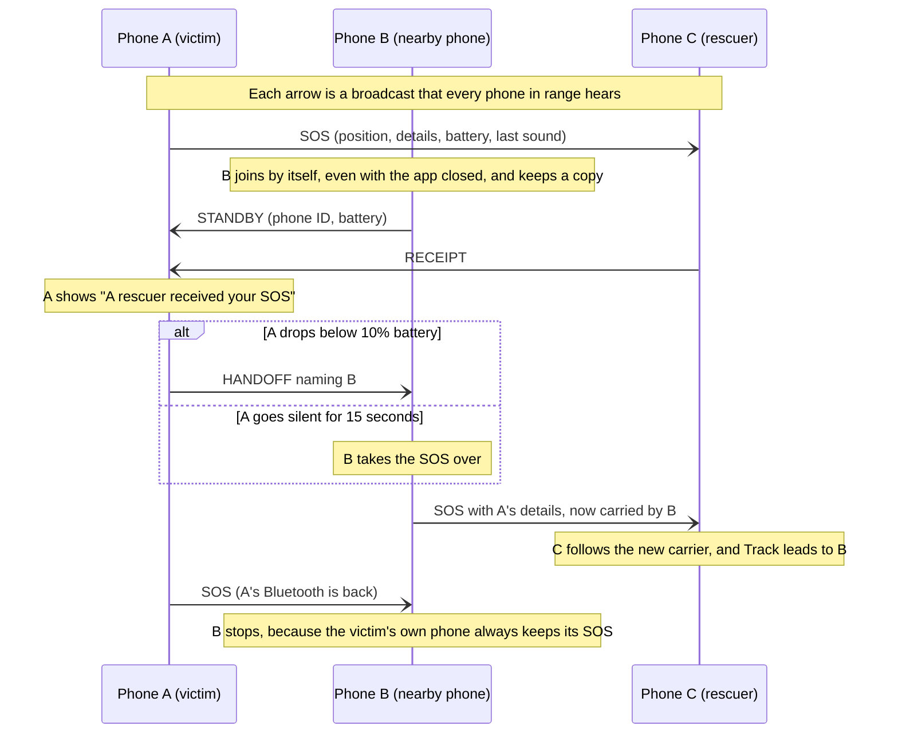

# FlareHop

FlareHop is a rescue app for Android that works with no cell towers, no internet and no pairing. A trapped person taps SOS once, and their phone keeps calling for help over Bluetooth, even after its battery dies.

- **The person who needs help** taps SOS. Their phone broadcasts a small Bluetooth LE packet with their GPS position, their battery level, and the last sign of life the phone heard (speech, shouting, knocking or crying). The packet also has room for how many people are there and whether anyone is injured or trapped.
- **Every Flarehop phone nearby** joins by itself, keeps a copy of every SOS it hears and reports its own battery. When a phone is about to die, the phone with the most charge takes over broadcasting its SOS, so the call for help outlives the phone that sent it.
- **A rescuer** opens the same app, sees every SOS in range ranked by urgency, sends a receipt back ("A rescuer received your SOS"), and follows the signal to the phone with Track.

Phones never connect to each other. Every phone only broadcasts and listens, the way avalanche beacons work.

> Hackathon project, built in a 24-hour event by a team of three.

## Status

| Part | What it does | State |
|---|---|---|
| Packet codec | Encodes and decodes the four 24-byte packet types and drops bad ones | Done |
| Flare engine | SOS records, receipts, signal readings, event log, cancel | Done |
| Radio | Bluetooth LE broadcast and scan in a foreground service | Done |
| Battery watcher | Reports the phone's battery to the engine every minute | Done |
| Phones find each other | Phones near an SOS join by themselves and report their battery; every phone lists the phones in range | Done |
| Handoff | Below 10% battery, hand every SOS a phone broadcasts to the phone in range with the most battery | Done |
| Takeover | A phone holding a copy takes an SOS over after 15 seconds of silence, 5 seconds later for each phone in range with more battery | Done |
| Conflicts | Two phones broadcasting the same SOS: the one with less battery stops, and the victim's own phone always keeps it | Done |
| Screens | Victim, Nearby, Rescuer and Track | Done |
| Priority score | Ranks every SOS by urgency | Done |
| Signs of life | On-device sound detection with YAMNet while this phone sends its own SOS, also with the screen off | Done |
| Auto-join with the app closed | After a reboot or when Android has closed the app, it wakes when it hears an SOS and joins as a carrier | Done |

Every part marked Done has been tried on real phones, except the handoff below 10% battery, which the unit tests prove. On phones, the takeover shows the same thing: turn the victim's Bluetooth off and a nearby phone keeps the SOS going.

## Using the app

The app has three tabs:

| Tab | What it shows |
|---|---|
| **Victim** | One big **SOS** button, then **Cancel SOS**. After sending it shows "SOS sent", "A rescuer received your SOS" once a rescuer answers, or "SOS handed on" with the phone that now sends it. Below that, the phones that can carry the SOS ("Connected: 2 phones", or "A rescuer has your signal" when only a rescuer has answered), and any other SOS nearby. The SOS goes out without a people count or conditions, so the victim has nothing to fill in. Once sent, the tab shows "You are phone 1A2B" in large type, so the victim can tell a rescuer which SOS is theirs. |
| **Nearby** | A north-up radar of every SOS and phone around you, placed by GPS where both phones have a fix and by Bluetooth signal otherwise, with a status line: "Looking for an SOS close by", "1 SOS close by", or "Carrying the SOS of phone 1A2B" when this phone took one over |
| **Rescuer** | **Set yourself as rescuer** (after a confirm), then every SOS this phone hears, ranked by urgency, each card headed by the victim's phone ID ("Phone 1A2B"), with the last sound the victim's phone detected, distance, how long since the last signal, battery and signal strength. **Track** opens Track for one SOS. **Stop being a rescuer** switches back. |

There is no Log or Demo tab: every rule shows in plain words on the three tabs, and in logcat for developers.

Track leads the rescuer to one SOS and shows what is known about it:

- **Direction.** When both phones have GPS and the victim is more than 30 m away, an arrow points at the victim and turns smoothly with the phone's compass. Closer than that, or without GPS, a needle leans toward Warmer or Colder as the Bluetooth signal rises or falls. Both glide instead of jumping.
- **Distance.** "About 12 m (±7 m), by GPS and signal", from GPS, the Bluetooth signal, or both.
- **Signal.** A meter, the signal in dBm, and beeps that speed up as you get closer. It averages the last 10 readings and shows "Signal lost" after 5 seconds without one.
- **Phones that carried this SOS.** The victim's phone and every phone that took it over, each with its last battery, signal and when it was last heard.
- **History.** Every change this phone heard, newest first: first heard, a new carrier, the victim sending again, sounds, a GPS position or a move, battery in 10% steps, and cancel. It is kept from the moment the rescuer's phone first hears the SOS, even before Track is opened.

A red banner on the Victim and Nearby tabs explains anything that stops the radio: Nearby devices not allowed, Location set to Approximate, Bluetooth off or Location off, each with a button to the right Settings page.

## How it works

Phones never pair or connect. Every phone broadcasts small packets and listens for everyone else's, so an SOS reaches every phone in range at once. This is how three phones keep one SOS alive:



Every message is exactly 24 bytes, sent as manufacturer data under company ID `0xFFFF` (reserved for testing) in a non-connectable Bluetooth LE advert. There are four packet types:

| Type | Sent by | Carries |
|---|---|---|
| SOS | The phone broadcasting that SOS | Message ID, origin and carrier phone IDs, position, accuracy, fix age, people count, injured / trapped / water / medical / fire flags, the broadcasting phone's battery, the victim's last sound |
| RECEIPT | A rescuer phone | The message ID it heard |
| STANDBY | Every phone except a rescuer, every 5 seconds, once there is an SOS around | Its phone ID and battery, and its own SOS's IDs if it has one |
| HANDOFF | A phone handing an SOS on | The phone taking over, or 0 to cancel |

A missing GPS fix is sent as the smallest 32-bit number, never as 0,0. Packets with the wrong length, version or type, an impossible position, or a zero ID where one is required are dropped.

A phone counts another phone as in range when it heard it at −70 dBm or stronger in the last 15 seconds. The engine lists those phones with their battery and how many SOS each is broadcasting, which the handoff uses to pick the phone with the most charge.

If an SOS whose carrier was in range goes silent for 15 seconds, a phone holding a copy takes it over and broadcasts it with the victim's details and sound and its own battery. Each phone in range with more battery adds 5 seconds to the wait, so the strongest phone acts first and the others hear it and stay quiet. Rescuers and phones below 10% battery never take over.

When phones that could not hear each other both took an SOS over and come back into range, the one with less battery stops (on a tie, the higher phone ID). If the victim's own phone is broadcasting again, every other carrier stops. A phone that stops keeps its copy, so it can take over again if the other carrier goes silent.

Once the app has been opened, Android keeps a low-power scan for Flarehop packets running for it, even after it closes the app, and again after a reboot. When that scan hears an SOS, the app starts its service by itself: it keeps the copy, sends STANDBY and can take the SOS over, as a rescuer if that phone was set as one. A phone woken this way uses only Bluetooth until its owner opens the app, because Android lets a service started in the background use location and the microphone only then. Tapping the notification opens the app, where the owner can send their own SOS. If Android refuses to start the service, the phone shows an "SOS nearby" notification instead, and one tap joins. After **Force stop** in Settings, Android delivers nothing to the app until it is opened again.

The flare engine is the only part of the app that talks to the radio. Screens call its actions (`sendSos`, `cancelSos`, `setFix`, `setRole`, `setBattery`, `setSound`, `reset`) and watch its streams (`mySos`, `knownSos`, `carried`, `group`, `directSignal`, `log`).

## Code layout

```
scripts/                       install-all.sh, mirror.sh, record-backup.sh
app/src/main/
├── assets/yamnet.tflite       sound model
└── java/com/flarehop/
    ├── MainActivity.kt         asks for permissions and starts the beacon
    ├── flare/                  radio and mesh (Project lead)
    │   ├── FlareConstants.kt   packet values, timings and thresholds
    │   ├── SosRecord.kt        SosRecord, SosDetails, Fix, SoundType
    │   ├── FlareEngine.kt      the engine interface the screens use
    │   ├── PacketCodec.kt      24-byte packet encode and decode
    │   ├── RealFlareEngine.kt  the engine: records, receipts, phones in range, handoff, takeover, conflicts, log
    │   ├── Flare.kt            the engine, battery watcher and signs of life the app shares
    │   ├── AdvertPlanner.kt    decides when to start, update, pause or resume the advert
    │   ├── BleAdvertiser.kt    broadcasts the engine's packets every 300 ms
    │   ├── BleScanner.kt       hears Flarehop packets and hands them to the engine
    │   ├── WakeScan.kt         the scan Android keeps running while the app is closed
    │   ├── WakeRule.kt         which packets wake the app (an SOS only)
    │   ├── WakeReceiver.kt     starts the service when the closed app hears an SOS
    │   ├── BootReceiver.kt     arms the wake scan again after a reboot or an update
    │   ├── WakeNotice.kt       the "SOS nearby" notification when Android refuses the start
    │   └── FlareService.kt     foreground service: radio, battery watcher and sound listener
    ├── ui/                     screens (App lead)
    │   ├── MainScreen.kt       the three tabs
    │   ├── VictimScreen.kt     Victim tab
    │   ├── NearbyScreen.kt     Nearby tab
    │   ├── SosListScreen.kt    Rescuer tab
    │   ├── FindScreen.kt       Track: direction, distance, signal, carriers and history
    │   ├── SosHistory.kt       the carriers and history Track shows
    │   ├── Heading.kt          compass heading and angle math for the Track arrow
    │   ├── LocationEstimator.kt distance and direction from GPS and Bluetooth signal
    │   ├── RadioCheck.kt       permission, Bluetooth and Location banner
    │   ├── LocationReader.kt   GPS or network location
    │   ├── FlareViewModel.kt, RoleStore.kt, RadarView.kt, GeoDistance.kt
    │   └── theme/
    └── sense/                  sound, battery, priority score (AI lead)
        ├── PriorityScore.kt    urgency score, bands and ranking
        ├── BatteryWatcher.kt   battery level every minute, with a demo override
        ├── YamnetListener.kt   microphone to the YAMNet model
        ├── SoundGate.kt        which sounds count: class, confidence and loudness
        └── SignsOfLife.kt      when to listen, and the fake knock
app/src/test/java/com/flarehop/
├── flare/      AdvertPlannerTest, MeshConflictTest, MeshGroupTest, MeshHandoffTest, MeshTakeoverTest, PacketCodecTest, RealFlareEngineTest, WakeRuleTest
├── handoff/    FakeRadio (several engines on an in-memory radio), RescueLoopTest, HandoffRulesTest
├── sense/      BatteryWatcherTest, PriorityScoreTest, SignsOfLifeTest, SoundGateTest
└── ui/         FindTrackerTest, LocationEstimatorTest, PhoneLabelTest, SosHistoryTest, AnglesTest
app/src/androidTest/java/com/flarehop/
└── sense/      YamnetLoadTest (runs on a phone)
```

Each person works only in their own package. `SosRecord`, `FlareEngine` and `FlareConstants` are shared contracts: only the Project lead changes them, after telling the team.

## Requirements

- Android Studio, latest stable
- Android SDK 37 (compile and target), minimum SDK 31 (Android 12)
- Gradle 9.6.0 through the wrapper. Gradle downloads the JDK 25 it runs on by itself; the app compiles to Java 11.
- Physical Android phones with 64-bit ARM processors (every recent phone). The app ships only the `arm64-v8a` build, which keeps it at about 66 MB. Emulators cannot advertise or scan over Bluetooth.

## Pinned versions

| Library | Version |
|---|---|
| Android Gradle Plugin | 9.5.1 |
| Kotlin | 2.2.10 |
| Compose BOM | 2026.02.01 |
| AndroidX core-ktx | 1.19.1 |
| AndroidX activity-compose | 1.13.0 |
| AndroidX lifecycle (runtime, viewmodel-compose) | 2.11.0 |
| kotlinx-coroutines (android, test) | 1.11.0 |
| MediaPipe tasks-audio | 1.2.2 |
| ktlint | 1.8.0 (Gradle plugin 14.2.0) |
| JUnit | 4.13.2 |

All versions live in `gradle/libs.versions.toml`.

## Setup

1. Clone the repo:
   ```
   git clone https://github.com/Aayushkumar-gupta/FlareHop.git
   ```
2. Open the folder in Android Studio and let Gradle sync.
3. Before every change, update `main` and branch from it:
   ```
   git checkout main
   git pull origin main
   git checkout -b <your-role>/<feature>
   ```

## Workflow

- Every change goes through a branch and a pull request into `main`.
- Only the Project lead merges, at the hour 5, 9 and 13 checkpoints and for urgent fixes in between.
- After the hour 13 feature freeze, only bug fixes are merged.

## Permissions

The app asks for these when it opens:

| Permission | Why |
|---|---|
| Nearby devices (Bluetooth advertise and scan) | To broadcast the SOS and hear other phones. Without it the beacon cannot start. |
| Location, **precise** | Android only delivers Bluetooth scan results to apps with precise location, because Bluetooth beacons can reveal where you are. With Approximate or none, the phone broadcasts but hears nothing. |
| Microphone | To listen for signs of life while this phone sends its own SOS, also with the screen off. Without it the SOS still goes out, without sounds. |
| Notifications (Android 13 and newer) | To show the "Flarehop is on" notification of the foreground service, and "SOS nearby" when the closed app hears one. |
| Location, **Allow all the time** | Asked once, after the first permissions. Android gives Bluetooth scan results to a closed app only with it, so without it the app cannot wake when it hears an SOS. Everything else still works. |
| Battery, **Unrestricted** (no battery optimisation) | Asked once, right after. It lets the woken app start its service by itself; without it Android may show the "SOS nearby" notification instead. |

The phone's **Location setting must be on** as well: with it off, Android delivers no Bluetooth scan results, and the app shows a banner saying so.

## Trying it on phones

You need two phones with Android 12 or newer, Bluetooth on and Location on.

1. Install it on each phone: `./gradlew installDebug` with the phones connected over USB, or **Run** in Android Studio.
2. Phone A: open Flarehop, allow every permission (Location: **Precise**), open **Victim** and tap **SOS**. The microphone now listens for signs of life, 5 seconds in every 15. To watch it, run `adb logcat -s YamnetListener`: every second it listens it logs the top sound, how loud it was, and what it sent (for example `Heard Knock 0.82, loudest -18.4 dBFS, sent KNOCK`).
3. Phone C: open Flarehop, allow every permission, open **Rescuer** and tap **Set yourself as rescuer**.
4. Within a few seconds phone C lists the SOS with its urgency, battery and signal, and phone A shows "A rescuer received your SOS".
5. On phone C, tap **Track** on the SOS and walk toward phone A: the needle leans to Warmer and the beeps speed up. Below, the SOS lists phone A as the victim and its history starts with "First heard".
6. Tap **Cancel SOS** on phone A. Phone C marks the SOS as cancelled.

With a third phone B open on **Nearby**, it joins by itself when phone A sends the SOS and shows "1 SOS close by". Then:

7. Turn Bluetooth off on phone A. After about 15 seconds phone B shows "Carrying the SOS of phone ..." and phone C keeps the SOS, now sent by B.
8. Turn Bluetooth back on on phone A. Within a few seconds phone B stops carrying it, because the victim's own phone always keeps its SOS.

To try waking with the app closed (phone B must have allowed Location **Allow all the time** and Battery **Unrestricted**):

1. Restart phone B and do not open Flarehop.
2. On phone A, send an SOS.
3. Within about a minute phone B shows the "Flarehop is on" notification without being touched, and phone C sees phone B in range. If phone B shows "SOS nearby" instead, Android refused the start: tap it to join.

To watch the radio and the sound listener in Logcat: `adb logcat -s FlareAdvertiser FlareScanner FlareWake YamnetListener`.

To check the raw packets without a second Flarehop phone, scan with nRF Connect and look for manufacturer data `0xFFFF`: an SOS starts with `21`, a receipt with `22`, a STANDBY with `23`.

## Demo scripts

Three scripts in `scripts/` run the phones for testing and the demo. They need `adb` and `scrcpy` on your PATH (macOS):

```
echo 'export PATH="$PATH:$HOME/Library/Android/sdk/platform-tools"' >> ~/.zshrc
source ~/.zshrc
brew install scrcpy
```

| Script | What it does |
|---|---|
| `scripts/install-all.sh` | Builds the app once, installs it on every phone plugged in over USB at the same time, and opens it |
| `scripts/mirror.sh [serial]` | Opens a scrcpy window for each phone (or only the one you name), keeping sound on the phone so Track's beeps stay audible |
| `scripts/record-backup.sh <serial>` | Records that phone's screen for the backup video and saves it twice, in `~/Movies/flarehop` and on the Desktop |

Find a phone's serial with `adb devices`. The scripts are bash, so on Windows they need Git Bash or WSL.

## Development tools

| Tool | What it does | Command |
|---|---|---|
| ktlint | Formats Kotlin and checks the code style. Settings are in `.editorconfig` (Android Studio style, 100-character lines, trailing commas). | `./gradlew ktlintFormat` fixes, `./gradlew ktlintCheck` checks |
| Android lint | Finds Android bugs, such as Bluetooth calls without a permission check | `./gradlew lintDebug` |
| Unit tests | JUnit tests that run on your computer | `./gradlew testDebugUnitTest` |
| On-phone tests | Tests that need a real phone, such as loading the sound model | `./gradlew connectedDebugAndroidTest` |
| CI | GitHub Actions runs ktlint, the unit tests and Android lint, and builds the APK, on every push to `main` and every pull request. It does not run the on-phone tests. | `.github/workflows/ci.yml` |

Before you push, run:
```
./gradlew ktlintFormat ktlintCheck testDebugUnitTest lintDebug
```
If CI shows a red cross on GitHub, open the run to see which step failed.

Android Studio picks up `.editorconfig` by itself, so **Code > Reformat Code** gives the same result as `ktlintFormat`.

## Running tests

Run all unit tests from the project folder:
```
./gradlew testDebugUnitTest
```
They run on your computer, with no phone needed. The HTML report is written to `app/build/reports/tests/testDebugUnitTest/index.html`.

In Android Studio you can also right-click a test file, such as `PacketCodecTest`, and choose **Run**.

| Test file | Checks |
|---|---|
| `AdvertPlannerTest` | When the advertiser starts, updates, skips an unchanged packet, pauses and resumes |
| `PacketCodecTest` | Round trips for all four packet types, exact byte layout, no-fix value, caps at 254, unknown values as 255, and the drop rules, including zero IDs |
| `MeshGroupTest` | Joining when an SOS is heard, STANDBY every 5 seconds, never from a rescuer, the −70 dBm range, carried counts, dropping silent phones after 15 seconds, and three phones finding each other on a fake radio |
| `MeshHandoffTest` | The handoff below 10% battery: the phone with the most battery wins, ties go to the lowest ID, unknown battery, weak signal and rescuers are never chosen, a carrier hands on everything it carries, the next phone is named after 30 seconds without an answer, the rescuer follows the new carrier with the victim's details, and cancel releases the carried copy |
| `MeshTakeoverTest` | Takeover after silence: the copy keeps the victim's details and sound, a weaker phone waits 5 seconds more per stronger phone, a dead carrier is taken over too, the rescuer sees the new carrier, and rescuers, phones below 10%, far-away carriers and cancelled SOS are never taken over |
| `MeshConflictTest` | Two carriers for one SOS: less battery stops and keeps its copy, a tie stops the higher ID, the victim coming back keeps its own SOS, the phone that stopped takes over again when the other dies, and the rescuer ends up hearing one carrier |
| `SosFixTest` | A GPS fix that arrives after the SOS went out reaches the rescuer under the same SOS, its age counts from when it arrived, nothing is sent without an SOS, and a phone that takes over carries the latest position |
| `WakeRuleTest` | Only an SOS wakes the closed app, not receipts, STANDBY, cancel or broken packets; a woken service starts with Bluetooth only, and an open app adds location and the microphone when they are allowed |
| `RealFlareEngineTest` | Sending an SOS, records for heard SOS, signal readings, dropped packets, receipts and the 15-second receipt window, acknowledgements, cancel, packet rotation and reset. Uses a fake clock, so no waiting |
| `RescueLoopTest` | Survivor and rescuer engines on a fake radio: the rescuer hears the SOS with its signal strength, the victim gets the receipt, out-of-range phones hear nothing, cancel reaches the rescuer |
| `HandoffRulesTest` | Contract 3's handoff rules on a fake radio, one test per rule: the strongest phone in range is named, ties, range, rescuers and unknown battery, the next phone after 30 seconds, a carrier hands on everything, the copy keeps the victim's data and sound with the carrier's battery, the SOS reaches phones the victim cannot reach, cancel, the last phone standing carrying every SOS, takeover after silence with the weaker phone standing down, and the carrier with less battery stopping when two carry one SOS |
| `PriorityScoreTest` | The four score checks from Contract 5, the 10-minute sound window, and ties going to the SOS heard first |
| `BatteryWatcherTest` | Battery pushed at start and every minute, the demo override, unreadable levels, stop |
| `SignsOfLifeTest` | The listening schedule, stopping below 15% battery, continuous listening, the fake knock |
| `SoundGateTest` | Which YAMNet classes count, the 0.5 confidence floor, and the loudness floor |
| `FindTrackerTest` | Track's meter from −90 to −40 dBm, beeps from 1500 ms down to 150 ms, averaging the last 10 readings, restarting on a new carrier, warmer or colder after a 3 dB change, and the dB change that leans the needle |
| `SosHistoryTest` | Track's carriers and history: the first packet, a new carrier and the victim sending again, sounds heard again, a GPS fix and real moves only, battery in 10% steps, cancel, and keeping the newest 100 entries |
| `AnglesTest` | The arrow's angle math: wrapping, turning the short way across north, compass smoothing, and animating without spinning the long way round |
| `LocationEstimatorTest` | Distance from Bluetooth signal, GPS error from both phones' accuracy, old or rough fixes ignored, combining GPS and Bluetooth, and when the direction is unknown |
| `PhoneLabelTest` | Phone IDs shown as four hex digits, keeping leading zeros, so the victim's screen and the rescuer's card match |

To run the on-phone test, plug in one phone with USB debugging on and run:
```
./gradlew connectedDebugAndroidTest
```
`YamnetLoadTest` loads the sound model on the phone and classifies one second of silence. It fails if the model cannot load, the problem that used to crash the app when an SOS was sent.

To build the app:
```
./gradlew assembleDebug
```

## License

Released under the MIT License. See [LICENSE](LICENSE).
